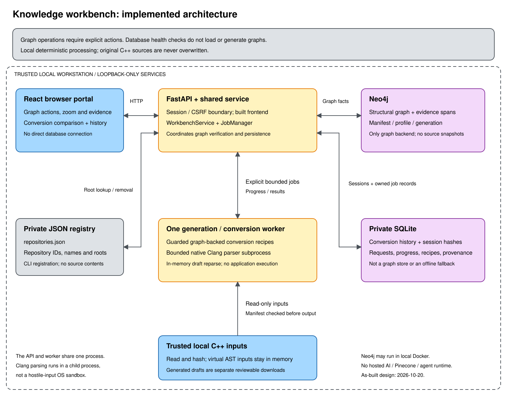

# Knowledge workbench architecture

**As-built design, 2026-10-20.** This describes the implemented local workbench,
not a proposed hosted knowledge platform or a new Squad role. The original C++
demonstration and four migration guides remain independent, preserved inputs.
Use the [operations guide](../tooling/knowledge-workbench/README.md) for setup and
the [browser guide](../tooling/knowledge-workbench/web/README.md) for interaction.

## System context

The workbench helps a developer inspect a trusted local C++ repository, explore
source-backed relationships, and prepare narrowly supported endian-conversion
drafts. The browser talks only to the local Python API. The API serves the built
React frontend and coordinates local parsing, graph persistence and job history.
No hosted model, embedding service, Pinecone, autonomous agent runtime or Azure
deployment is part of this implementation.

[Editable Excalidraw source](../images/knowledge-workbench-architecture.excalidraw).
Arrows show logical interactions, not independent deployable microservices.
The parser is a child process; the job manager and shared service run inside the
API process. The Neo4j box represents the configured local database, which may
run in the dedicated development container.

## Components and responsibilities

| Component | Responsibility | Implementation |
|---|---|---|
| React browser portal | Repository selection, profile assessment, explicit graph actions, zoom/pan, evidence, conversion comparison and history | [`App.tsx:230-315`](../tooling/knowledge-workbench/web/src/App.tsx#L230-L315), [`GraphExplorer.tsx`](../tooling/knowledge-workbench/web/src/GraphExplorer.tsx), [`ConversionWorkspace.tsx`](../tooling/knowledge-workbench/web/src/ConversionWorkspace.tsx) |
| FastAPI boundary | Same-origin local session, CSRF checks, bounded requests, API routes and static frontend delivery | [`api.py:271-414`](../tooling/knowledge-workbench/src/knowledge_workbench/api.py#L271-L414) |
| Shared service | Registry lookup, source checks, Neo4j access, generation, conversion verification and document exports | [`service.py:126-264`](../tooling/knowledge-workbench/src/knowledge_workbench/service.py#L126-L264) |
| Job manager | One shared generation/conversion worker, progress, ownership, cancellation and persistence coordination | [`api.py:76-237`](../tooling/knowledge-workbench/src/knowledge_workbench/api.py#L76-L237) |
| Inventory and native AST parser | Restricted C++ input discovery, hashes, audited includes, native Clang analysis and source evidence | [`core.py:177-231`](../tooling/knowledge-workbench/src/knowledge_workbench/core.py#L177-L231), [`parser.py:27-73`](../tooling/knowledge-workbench/src/knowledge_workbench/parser.py#L27-L73), [`parser.py:169-260`](../tooling/knowledge-workbench/src/knowledge_workbench/parser.py#L169-L260) |
| Guarded conversion engine | Consume verified graph facts, plan supported rewrites, retain blockers and reparse draft output | [`conversion.py:358-550`](../tooling/knowledge-workbench/src/knowledge_workbench/conversion.py#L358-L550), [`conversion.py:556-615`](../tooling/knowledge-workbench/src/knowledge_workbench/conversion.py#L556-L615) |
| Storage adapters | Neo4j publication/load, private SQLite jobs/sessions and JSON root registration | [`neo4j_store.py:63-153`](../tooling/knowledge-workbench/src/knowledge_workbench/neo4j_store.py#L63-L153), [`job_store.py:44-224`](../tooling/knowledge-workbench/src/knowledge_workbench/job_store.py#L44-L224), [`service.py:19-123`](../tooling/knowledge-workbench/src/knowledge_workbench/service.py#L19-L123) |

The CLI is a second local entry point to the shared service, not an HTTP client
and not an agent. Registration is a CLI operation. Stop the API before CLI
registration, generation or removal: the state-directory runtime lock prevents
competing writers. Generation and conversion share a single worker; a second
active request is rejected as `busy`, not silently queued behind existing work.

## Data ownership and persistence

| Store | Authoritative data | Deliberately absent |
|---|---|---|
| Registered repository | Current UTF-8 C++ inputs; the manifest is checked against these files | In-place application of generated conversion drafts |
| Neo4j | Current structural graph, source manifest, compiler profile, diagnostics, evidence spans and generation identity | Full source snapshots, embeddings or a complete build/dependency model |
| SQLite `conversions.sqlite3` | Conversion requests, progress, recipes, blockers, provenance, timestamps, hashed ownership and session expiry | A second graph backend, full source snapshots or raw bearer/CSRF tokens |
| JSON `repositories.json` | Registered repository IDs, display names and absolute local roots | Source contents or database credentials |

The state directory is `$XDG_STATE_HOME/os400-knowledge-workbench`, falling back
to `~/.local/state/os400-knowledge-workbench`. Directory permissions are `0700`;
the SQLite database and registry are private `0600` files. These are local-file
permissions, not encryption or isolation from other processes running as the
same user. Graph metadata, root paths, recipes and exported material can still
be sensitive.

SQLite keeps the latest **100 conversions across sessions**; history queries are
filtered to the owning browser session and repository. The manager caches at
most eight conversion jobs in memory. Session hashes have an eight-hour lifetime
renewed when a session is established. Keeping a valid owning cookie allows
history access after restart; a different session does not inherit ownership.
Unfinished saved conversions become `interrupted` on startup and never resume
automatically. Graph-generation jobs are not durable conversion-history entries.

Sources: [`job_store.py:20-74`](../tooling/knowledge-workbench/src/knowledge_workbench/job_store.py#L20-L74),
[`job_store.py:146-224`](../tooling/knowledge-workbench/src/knowledge_workbench/job_store.py#L146-L224),
[`api.py:110-137`](../tooling/knowledge-workbench/src/knowledge_workbench/api.py#L110-L137)
and [`service.py:19-90`](../tooling/knowledge-workbench/src/knowledge_workbench/service.py#L19-L90).

## Explicit graph lifecycle

1. **Connect and select.** Establish a browser session, list registered roots and
   check both databases. Page load, selection, reconnect and conversion-workspace
   mount do not read or generate repository graphs. Health checks only query
   database readiness; a green light is not a usable conversion context.
2. **Assess.** Choose compiler settings and explicitly assess the allowed inputs.
   Inventory validates paths, file budgets and source hashes without executing
   repository build scripts. Use **C++20** for this repository's modernized
   example because it uses `std::endian`.
3. **Generate.** **Generate graph** submits the selected profile to the single
   worker. The parser subprocess receives bounded input, audits includes and
   maps local C++ inputs into a virtual in-memory tree. It extracts declarations,
   fields, calls, references, evidence and diagnostics using native libclang.
   Unsupported or missing information remains diagnostic or unresolved.
4. **Publish.** Recheck the source manifest, then publish graph data and move the
   repository's `CURRENT` pointer in one Neo4j data transaction. Failure rolls
   back publication and retains the prior generation. A successfully published
   graph may be `partial`; conversion requires `complete`. Publication replaces
   the prior generation rather than retaining an immutable graph history.
5. **Explore.** Completion of an explicitly requested generation can display its
   graph. **Load current graph** explicitly retrieves an existing generation.
   Every service graph load verifies the manifest. Evidence excerpts are reread
   from current source bytes, not recovered from a stored source snapshot.

The SVG is a bounded view: at most 36 matching nodes and 100 links, with a
100-row-per-page symbol table. Its 50-300% zoom, pan and fit controls change the
viewport, not the underlying graph. This is a structural explorer, not semantic
retrieval or proof that every runtime call relationship is known.

Sources: [`App.tsx:297-315`](../tooling/knowledge-workbench/web/src/App.tsx#L297-L315),
[`ConversionWorkspace.tsx:56-80`](../tooling/knowledge-workbench/web/src/ConversionWorkspace.tsx#L56-L80),
[`service.py:158-244`](../tooling/knowledge-workbench/src/knowledge_workbench/service.py#L158-L244),
[`neo4j_store.py:63-153`](../tooling/knowledge-workbench/src/knowledge_workbench/neo4j_store.py#L63-L153)
and [`core.py:177-231`](../tooling/knowledge-workbench/src/knowledge_workbench/core.py#L177-L231).

## Graph-backed conversion lifecycle

1. **Enter deliberately.** **Convert code** opens the conversion workspace while
   preserving the repository selection. It does not start a job or fetch graph
   context. **Refresh graph context** explicitly requests that context.
2. **Establish assumptions.** Assess/select inputs, match the graph's compiler
   profile and confirm the record assumptions. The service loads the current
   Neo4j generation; it does not substitute SQLite or a newly inferred input
   graph when the stored graph is unavailable.
3. **Plan safely.** Require the same repository, matching profile, complete
   analysis and unchanged source manifest. Consume graph record/call/access
   facts. Only narrow standalone fixed-record `memcpy` patterns qualify.
   Aliases, escapes, unconsumed endian-helper calls, unsupported numeric writes
   and uncertain layouts block conversion instead of producing a success-shaped
   fallback. Already recognized portable decoders can remain unchanged.
4. **Validate the draft.** Render rewrites in memory and reparse a C++20 virtual
   tree, including independent validation-only layout checks for already
   modernized code. This parse is a validation of generated output, not a
   replacement for the Neo4j graph used to plan the conversion. It does not build
   or execute the application.
5. **Persist and review.** Save owned requests, progress, recipes and provenance
   to SQLite. Before previews or downloads, recheck current source hashes,
   Neo4j generation identity/digest and recipe safety version. A source change,
   graph replacement or obsolete recipe requires a new conversion. Downloads
   remain drafts requiring human and target-platform review.

As of this design snapshot, the graph fingerprint is `generation-v4`, function
conversion analysis is version `2` and saved recipe safety is version `3`.
These separate compatibility gates prevent old graph facts or saved recipes
from silently satisfying newer checks. The conversion budget is 20 selected
files, 250 KB per selected file and 1 MB across inventoried inputs.

Sources: [`service.py:183-208`](../tooling/knowledge-workbench/src/knowledge_workbench/service.py#L183-L208),
[`conversion.py:142-185`](../tooling/knowledge-workbench/src/knowledge_workbench/conversion.py#L142-L185),
[`conversion.py:450-550`](../tooling/knowledge-workbench/src/knowledge_workbench/conversion.py#L450-L550),
[`conversion.py:556-615`](../tooling/knowledge-workbench/src/knowledge_workbench/conversion.py#L556-L615)
and [`parser.py:245-248`](../tooling/knowledge-workbench/src/knowledge_workbench/parser.py#L245-L248).

## Trust, failure and operational boundaries

The intended environment is a trusted local workstation with loopback-only API
and database connections. Host/origin checks, an HttpOnly SameSite cookie,
session ownership and CSRF checks constrain browser access; they are not a
multi-user identity system or authorization to expose the service publicly.
The dedicated unauthenticated Neo4j container is only a development option,
explicitly configured for an isolated loopback database.

Source inventory rejects unsafe paths and symlinks. Parsing uses a cancellable,
time-bounded subprocess and bounded graph output; it never runs repository build
scripts. This child process is not a hostile-input OS sandbox. Only trusted
repositories belong in the current design.

| Failure | Expected behavior |
|---|---|
| Neo4j unavailable or graph absent | Readiness or graph operation reports an error; no SQLite graph fallback |
| Profile mismatch, stale source or partial graph | Block conversion; correct the settings/inputs and explicitly regenerate |
| Parser failure or publication failure | Report a failed job; failed publication does not replace the prior graph |
| SQLite unavailable or invalid | Report persistence/readiness failure rather than claiming durable success |
| Interrupted conversion or outdated recipe | Keep history with its status; do not automatically rerun or serve obsolete validated output |
| Competing server/CLI writer or active job | Reject with `job_store_busy` or `busy`; stop/wait/cancel explicitly |
| Cancellation after publication begins | Reject cancellation rather than imply an atomic publication was undone |

Sources: [`api.py:271-380`](../tooling/knowledge-workbench/src/knowledge_workbench/api.py#L271-L380),
[`api.py:155-230`](../tooling/knowledge-workbench/src/knowledge_workbench/api.py#L155-L230),
[`job_store.py:76-144`](../tooling/knowledge-workbench/src/knowledge_workbench/job_store.py#L76-L144)
and [`parser.py:27-73`](../tooling/knowledge-workbench/src/knowledge_workbench/parser.py#L27-L73).

## Design choices and limits

| Choice | Benefit | Tradeoff |
|---|---|---|
| Neo4j as the sole graph backend | One graph provenance and publication path | Graph-backed work requires the local database |
| SQLite for private job/session persistence | Restart-safe local history without duplicating graph storage | Retention and browser ownership are bounded; no shared account history |
| Deterministic native AST facts, not hosted inference | Source evidence without source uploads or invented relationships | Native compiler/dialect limits remain visible; no semantic search |
| Explicit actions and one shared worker | Predictable work, no initial graph scan and bounded concurrency | Manual generation/refresh; no unattended indexing or parallel conversions |
| Recipes plus current-source reconstruction | No full source snapshots or in-place rewrites | Old outputs become unavailable when their source or graph is no longer current |
| Native SVG explorer | No additional graph-rendering dependency | Bounded structural view, not a large-graph visualization engine |

No claim of successful Linux x86-64, IBM i/big-endian, MSVC, DB2, EBCDIC or
packed/zoned-decimal modernization follows from a local parse or native macOS
ARM64 result. Browser end-to-end and target-platform validation remain separate
from the existing unit/build checks. The [operations guide's checks](../tooling/knowledge-workbench/README.md#checks)
describe the existing validation commands.

The [historical reinvention proposal](reinvention/README.md) remains background
research, not the as-built architecture or proof that its future gates passed.
Future retrieval, agent or hosted deployment work needs its own authorization,
data-handling decision, evaluation and updated design.
